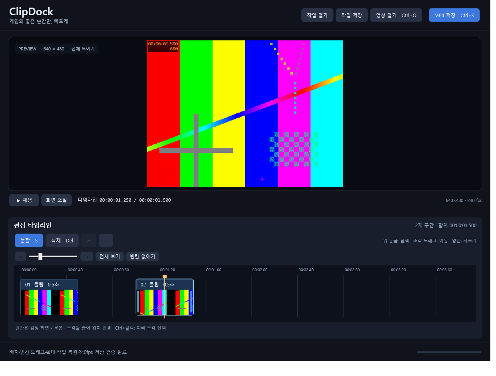

# ClipDock

게임 영상을 빠르게 자르고 배치하는 Windows 클립 편집기입니다.
자막·음악 편집 없이 필요한 장면을 남기고 원하는 화면 비율과 FPS로 저장합니다.

## 다운로드와 실행

[최신 Release](https://github.com/chsportfor/ClipDock/releases/latest)에서
**ClipDock-v0.2.0-win-x64.zip**을 받아 압축을 풀고 **Start-ClipDock.cmd**를 실행하세요.

처음 한 번은 Gyan 공식 배포처에서 FFmpeg 도구(약 109MB)를 내려받고 SHA-256을
확인합니다. 관리자 권한은 필요 없습니다. 준비가 끝나면 **ClipDock.exe**로 바로 실행할 수 있습니다.

**ClipDock.exe 단독 파일**은 기존 tools 폴더가 있는 사용자를 위한 업데이트 파일입니다.
처음 사용하는 경우 ZIP을 선택하세요. 소스 저장소에는 EXE, 외부 실행 도구, 사용자 영상이 없습니다.

- Windows 10/11 x64, .NET Framework 4.8 권장
- 최초 도구 설치 시 인터넷 연결 필요
- NVIDIA 저장은 NVENC 지원 그래픽카드와 드라이버 필요

## 편집

1. 영상을 열거나 창으로 끌어다 놓습니다.
2. 타임라인 위 시간 눈금을 클릭해 위치를 고르고 **S**로 분할합니다.
3. 조각을 선택하고 **Delete**로 지웁니다. 다른 조각의 위치와 빈자리는 유지됩니다.
4. 조각 몸통을 끌어 이동하고, 양끝을 끌어 길이를 바꿉니다.
5. **재생 / Space**로 편집한 타임라인을 바로 재생합니다.
6. **MP4 저장**에서 비율·화면 맞추기·해상도·FPS를 고르고 저장합니다.

빈칸은 검정 화면과 무음으로 재생·저장됩니다. 붙이고 싶을 때 **빈칸 없애기**를
누르세요. 마지막 조각 뒤 작업공간은 저장하지 않습니다.
겹치는 위치에 놓으면 다른 조각을 덮어쓰지 않고 이동을 취소합니다.

- 원본 / 16:9 / 9:16 / 4:3 / 1:1 비율, 여백 또는 채우기
- 원본 FPS 유지 및 1~1000 FPS 직접 입력, 240 FPS 저장 지원
- 높은 FPS를 입력해도 원본에 없는 동작을 보간하지 않습니다.
- Ctrl+클릭으로 여러 조각 선택·동시 이동
- Ctrl+J로 묶기 / Ctrl+Shift+J로 풀기
- Ctrl+Z로 실행 취소 / Ctrl+Y로 다시 실행
- Ctrl+Shift+S로 작업 저장 / Ctrl+Shift+O로 불러오기
- Ctrl+S로 MP4 저장 / 방향키로 한 프레임 이동
- 휠·슬라이더로 타임라인 확대 / 가로 스크롤로 이동
- 최소 창 크기 640×600, 작은 창에 맞춰 버튼·안내 정리

실시간 재생은 Windows의 코덱 지원과 PC 성능에 영향을 받습니다.
일부 코덱의 실시간 재생이 지원되지 않아도 FFmpeg 정지 화면 탐색과 저장을 사용할 수 있습니다.
잘라낸 경계는 비파괴 방식이므로 끝부분을 늘리면 원본 앞뒤 장면이 다시 나타납니다.

## 영상 크기와 위치 맞추기

미리보기 아래 **화면 조절**을 눌러 설정을 펼칩니다. 설정을 열어도 미리보기 공간은 밀리지 않습니다.

1. **출력 화면**에서 1920×1080, 1080×1920, 정사각형 또는 원본 화면을 고릅니다.
2. **크기 슬라이더**로 10~500% 범위에서 확대·축소합니다. 영상 위 마우스 휠도 사용할 수 있습니다.
3. **영상 자체를 드래그**해서 가로·세로 위치를 맞춥니다.
4. 화면 조절을 닫거나 **Esc**를 누른 뒤 재생·저장합니다.

- **전체 보이기**: 원본 비율을 유지하고 전체 장면을 보여줍니다.
- **여백 없이 채우기**: 비율을 유지하면서 화면을 채웁니다. 가장자리는 잘릴 수 있습니다.
- **화면에 늘림**: 출력 비율에 맞춰 가로·세로를 각각 늘립니다. 장면의 비율이 달라질 수 있습니다.
- **초기화**: 전체 보이기, 100%, 가운데 위치로 돌아갑니다.

녹화 영상 안에 검은 테두리가 들어 있으면 필요한 만큼 확대해서 화면 밖으로 잘라낼 수 있습니다.
미리보기에서 고른 크기·위치는 실제 저장과 작업 파일에도 반영됩니다.
화면 조절은 현재 영상 전체에 적용되며, 드래그·프리셋 조작은 Ctrl+Z로 되돌릴 수 있습니다.
기존 작업 파일은 원래 모습으로 열립니다.

## 소스에서 빌드

Windows PowerShell에서:

~~~powershell
.\Setup-FFmpeg.ps1
.\src\build.ps1
.\src\test.ps1
~~~

별도 NuGet 패키지 없이 .NET Framework C# 컴파일러와 WPF를 사용합니다.
결과는 루트 ClipDock.exe입니다. 테스트는 합성 영상으로 편집·빈칸·실시간 재생·작업 복원·
작은 창·저장 설정과 240 FPS 출력 등을 확인합니다. 테스트 영상과 결과는 Git에서 제외합니다.

배포 파일 생성:

~~~powershell
.\Build-Release.ps1 -Version 0.2.0
~~~

## 외부 도구

FFmpeg와 ffprobe는 별도 프로그램이며 이 저장소와 Release에 바이너리를 포함하지 않습니다.
설치 스크립트가 Gyan의 FFmpeg 9.0.2 essentials 빌드를 직접 내려받고
배포본의 라이선스·빌드 설명을 tools에 보관합니다.

- [Gyan Windows 빌드](https://www.gyan.dev/ffmpeg/builds/)
- [FFmpeg 프로젝트](https://ffmpeg.org/)
- [사용하는 FFmpeg 소스](https://github.com/FFmpeg/FFmpeg/commit/946fcce07b)
- FFmpeg 해당 빌드 라이선스: GPLv3
